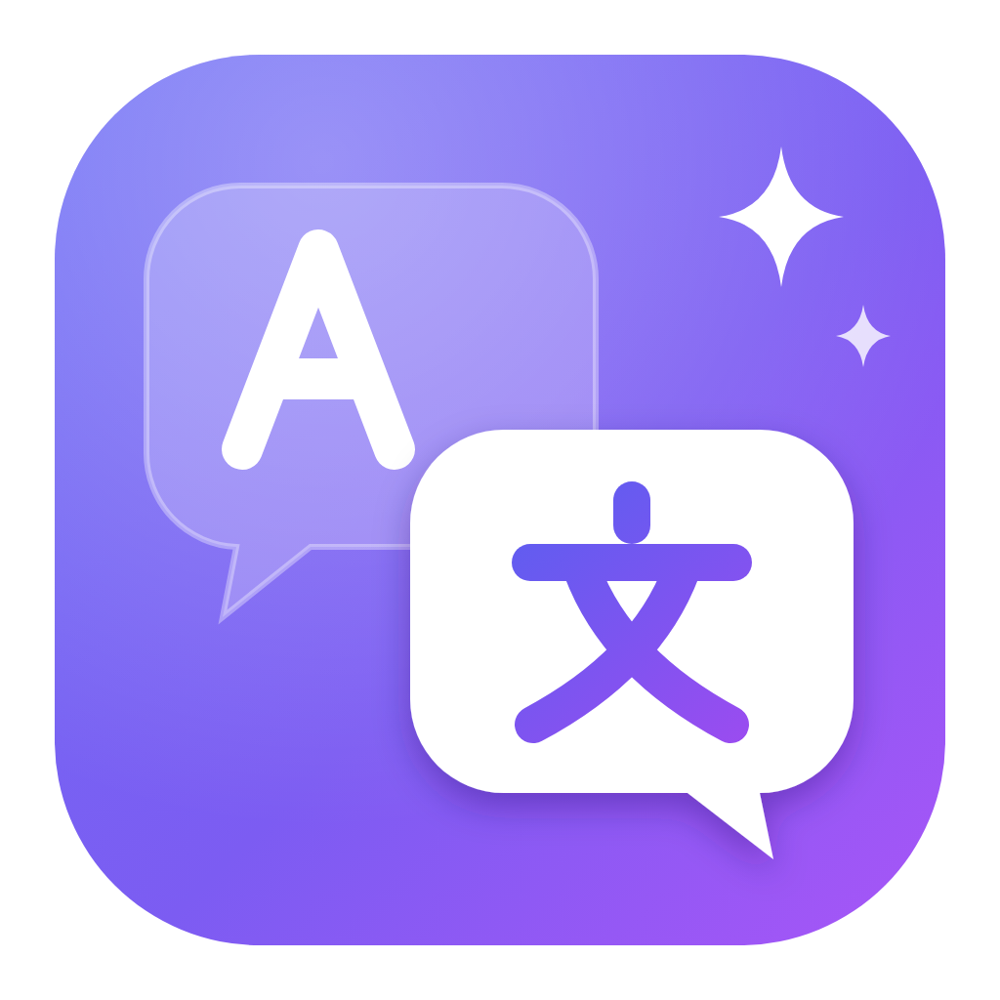
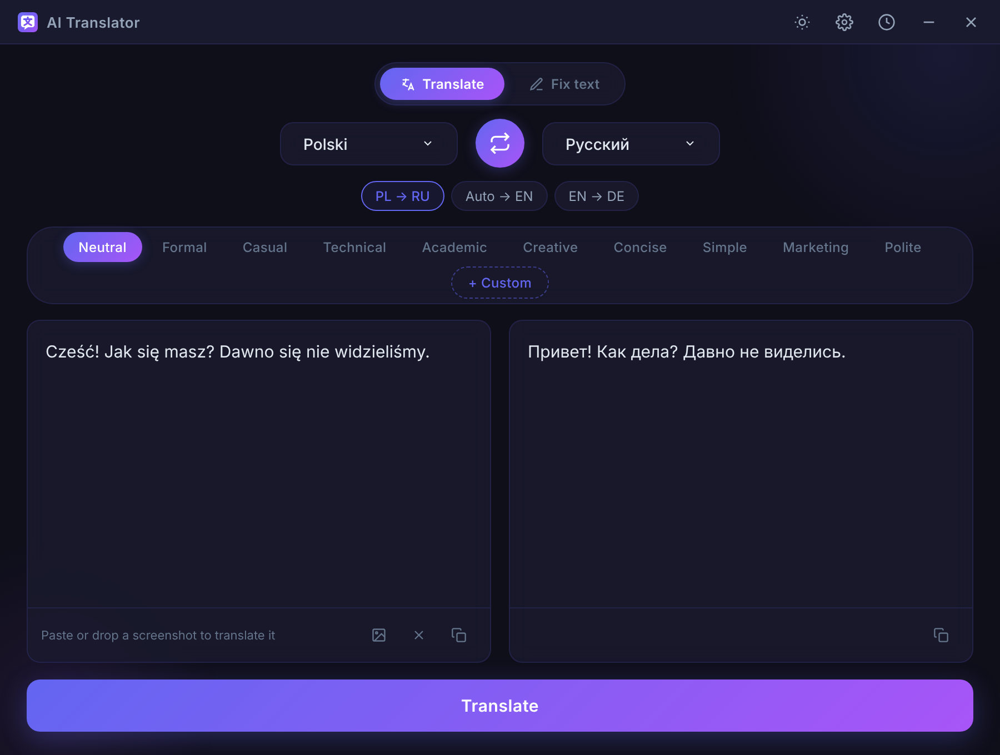
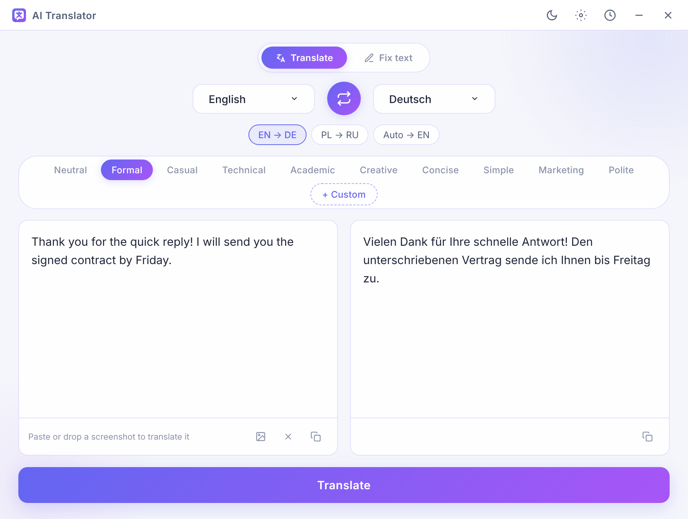
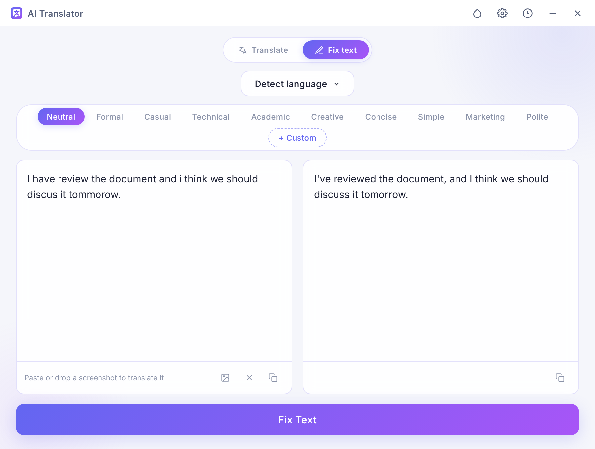
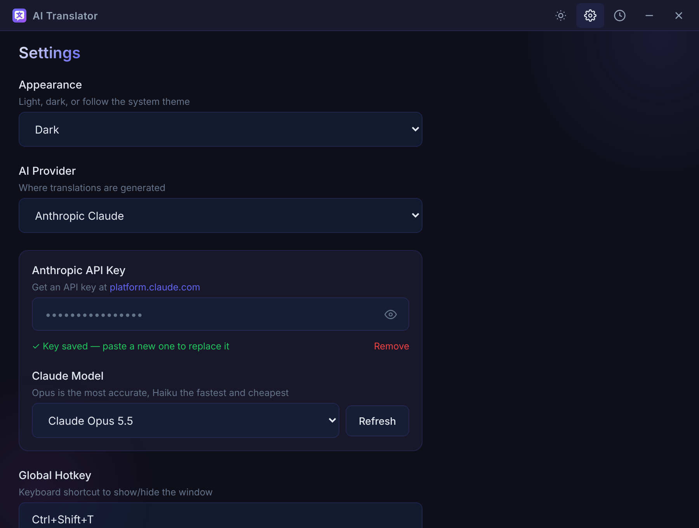
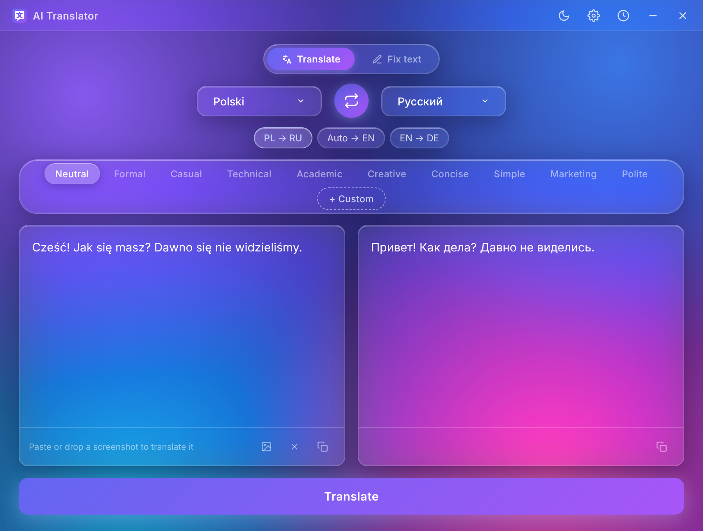
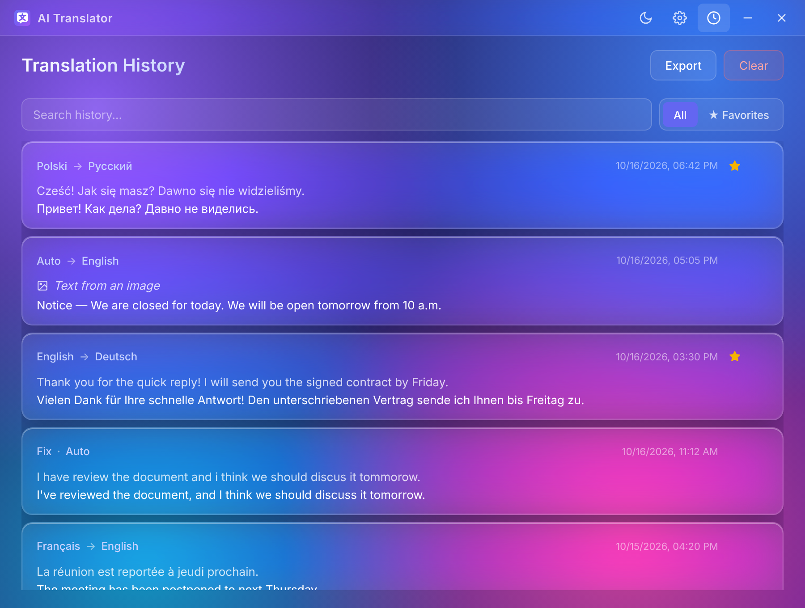
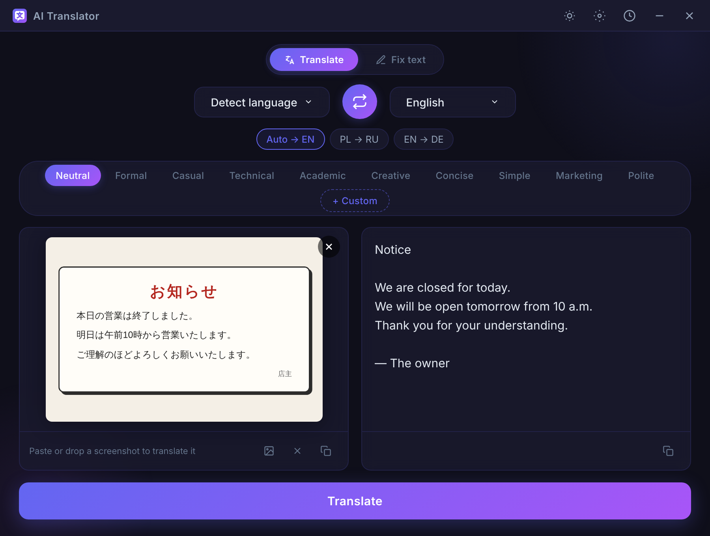
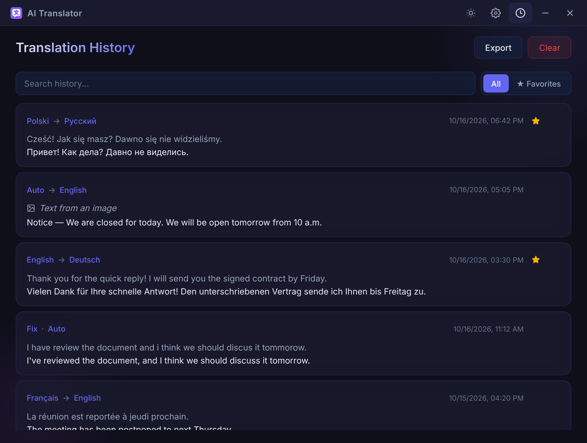

<div align="center">



# ✦ AI Translator

**Desktop Translator powered by Google Gemini, Anthropic Claude and OpenRouter**

*Fast, beautiful, and smart text translation supporting 30+ languages*

[](https://www.electronjs.org/)
[](https://ai.google.dev/)
[](https://platform.claude.com/)
[](https://openrouter.ai/)
[](LICENSE)

[](https://github.com/PabloSensei/ai-translator/releases/latest)
[](https://github.com/PabloSensei/ai-translator/releases)
[](https://github.com/PabloSensei/ai-translator/stargazers)
[](https://github.com/PabloSensei/ai-translator/actions/workflows/release.yml)

</div>

---

## 🌟 Features

- 🌍 **30+ Languages** — supports translation between English, Russian, German, French, Spanish, Ukrainian, Chinese, Japanese, Korean, Arabic, and many other languages
- 🔎 **Automatic Language Detection** — leave the source set to *Detect language* and the model works it out
- 🛠️ **Translate / Fix text Modes** — one toggle switches between translating and correcting spelling and grammar in place
- 🎨 **10 Translation Styles + Custom** — formal, neutral, casual, technical, academic, creative, concise, simple, marketing and polite, plus your own saved styles
- 🌓 **Light, Dark, Glass & System Themes** — including a translucent iOS-style glass theme that blurs the desktop behind the window
- ⚡ **Instant, Streamed Translation** — use `Ctrl+Enter` or the "Translate" button; the result appears word by word as it is generated, and **Stop** cancels it
- 📌 **Translate Selection** — select text in any app and press `Ctrl+Shift+Y`: the translator pops up and translates it
- 🖼️ **Translate Screenshots** — paste (`Ctrl+V`), drop or pick an image, or copy a screenshot and press `Ctrl+Shift+Y`: the model reads the text in it and translates it
- 🔥 **Gemini, Claude & OpenRouter** — pick from the latest Gemini models (including Gemini 3.8 Flash), Anthropic's Claude models (Opus 5.5, Sonnet 5.5, Haiku 5.5), or plug in an OpenRouter key and choose from its whole catalogue
- 🔄 **Quick Language Swap** — the swap button instantly switches languages and text
- 📋 **Translation History** — the last 100 translations, with search, ★ favorites (kept forever) and export to CSV, JSON or Markdown
- ⌨️ **Global Hotkey** — summon the translator from any application (default `Ctrl+Shift+T`)
- 🎯 **Recent Language Pairs** — the quick-access row is built from the pairs you actually use
- 🔒 **System Tray** — runs in the background and is always at your fingertips
- 🔔 **Automatic Updates** — new versions download in the background and install on the next restart

## 🖥️ Screenshots

<div align="center">

| Dark theme | Light theme |
|:---:|:---:|
|  |  |
| **Fix text mode** | **Settings** |
|  |  |
| **Glass theme** | **Glass: history** |
|  |  |
| **Text from a screenshot** | **History** |
|  |  |

</div>

## 🚀 Installation

### Requirements

- [Node.js](https://nodejs.org/) 20+ (only for building from source)
- A [Google Gemini](https://aistudio.google.com/apikey), [Anthropic](https://platform.claude.com/settings/keys) or [OpenRouter](https://openrouter.ai/keys) API key

### Pre-built Release (recommended)

Download the latest version from [Releases](https://github.com/PabloSensei/ai-translator/releases):

| Platform | Package |
|----------|---------|
| 🪟 **Windows** | `AI-Translator-Setup-<version>.exe` |
| 🍏 **macOS** | `AI-Translator-<version>-arm64.dmg` |
| 🐧 **Linux** | `AI-Translator-<version>-x86_64.AppImage` or `AI-Translator-<version>-amd64.deb` |

After downloading, install and launch — no Node.js or npm required.

The builds are not code-signed, so the OS warns on the first launch:

- **Windows** — SmartScreen shows *"Windows protected your PC"*: click **More info → Run anyway**.
- **macOS** — right-click the app in *Applications* and choose **Open**, then **Open** again (or *System Settings → Privacy & Security → Open Anyway*). If macOS says the app *"is damaged"*, run `xattr -cr "/Applications/AI Translator.app"` once.
- **Linux** — make the AppImage executable: `chmod +x AI-Translator-*.AppImage`.

### Build from Source

1. **Clone the repository:**

```bash
git clone https://github.com/pablosensei/ai-translator.git
cd ai-translator
```

2. **Install dependencies:**

```bash
npm install
```

3. **Run the application:**

```bash
npm start
```

4. **Configure your API Key:**
   - Click the ⚙️ icon in the top panel
   - Pick a provider — **Google Gemini**, **Anthropic Claude** or **OpenRouter**
   - Paste the matching API key, then press *Refresh* / *Load models* to pick a model
   - Click "Save Settings"

## 📖 Usage

### Basic Translation
1. Pick the target language — leave the source on **Detect language** or choose one
2. Enter or paste text
3. Click **"Translate"** or press `Ctrl+Enter`

The row under the language bar shows the language pairs you used most recently — click one to restore it.

### Text from Images
Paste a screenshot with `Ctrl+V`, drop an image file onto the input panel, or click the 🖼 button to pick one, then press **Translate**. The model reads the text in the image and translates it (or, in *Fix text* mode, corrects it). Copying a screenshot (`Win+Shift+S`, `Cmd+Ctrl+Shift+4`, `PrtSc`) and pressing the *Translate selection* hotkey does the same in one step.

Works with Gemini and Claude models, and with OpenRouter models that accept images. Images are scaled down to 2000 px on the long side before sending; they are not stored in the history.

### Translate / Fix text
The toggle above the language bar switches between the two modes:

| Mode | What it does |
|------|--------------|
| 🌐 **Translate** | Translates from the source (or auto-detected) language into the target language |
| ✏️ **Fix text** | Corrects spelling, grammar, and punctuation **in the original language** — the target language is hidden |

The selected style applies in both modes, so *Fix text* + *Formal* also rewrites the text in a formal tone.

### Translation Styles
Switch style with one click:

| Style | Description |
|-------|-------------|
| 😊 **Neutral** | Standard translation, no tonal shift |
| 💼 **Formal** | Business, professional tone |
| 💬 **Casual** | Informal and friendly |
| 🔧 **Technical** | Keeps terminology, identifiers, and units intact |
| 🎓 **Academic** | Scholarly register, measured phrasing |
| ✨ **Creative** | Expressive and literary, preserves imagery |
| ✂️ **Concise** | Strips filler, keeps only the essentials |
| 🧒 **Simple** | Plain language, no jargon or idioms |
| 📣 **Marketing** | Persuasive, benefit-focused copy |
| 🙏 **Polite** | Especially courteous and diplomatic |

Press **+ Custom** to define your own: give it a name and an instruction (for example *"Use legal contract wording"*). Custom styles are saved and appear alongside the built-in ones; the `×` on a custom chip deletes it.

### Themes
The button in the title bar cycles **Dark → Light → Glass**; Settings → Appearance also offers **System**, which follows the OS theme.

**Glass** is a translucent, frosted theme in the spirit of iOS:
- **macOS** and **Windows 11** — the window is see-through: the desktop shows behind it, blurred by the system (vibrancy on macOS, Acrylic on Windows). Untick *See-through* under Appearance to keep a backdrop inside the window instead.
- **Linux** and **Windows 10** — the OS cannot blur behind a window, so the window paints its own colourful backdrop under the frosted panels.

### AI Providers

| Provider | Notes |
|----------|-------|
| **Google Gemini** | Ships with a curated list of current models; *Refresh* queries the API for every model your key can access |
| **Anthropic Claude** | Uses the official Anthropic SDK. Defaults to Claude Opus 5.5; *Refresh* lists every Claude model your key can access. If a safety classifier declines a request, it is retried server-side on Anthropic's recommended fallback model |
| **OpenRouter** | Paste an OpenRouter key, press *Load models*, then filter and select any model in its catalogue |

Either way the picker only lists models that reply with text — image, audio, video, music and embedding models are filtered out, even though the APIs report many of them as usable.

### Updates
Installed builds update themselves from GitHub Releases: a few seconds after start (and every 6 hours) the app checks for a new version, downloads it in the background and installs it the next time it restarts. When an update is ready you get a notification, a **Restart & install** button in Settings → About, and a **Restart to Install** item in the tray menu.

Untick *Download updates automatically* to be asked first. Running from source (`npm start`) only checks whether a newer release exists and links to it.

| Platform | Automatic updates |
|----------|-------------------|
| Windows (installer) | ✅ |
| Linux AppImage | ✅ |
| Linux `.deb` | ✅ (asks for your password to install) |
| macOS | 🔔 notifies and links to the download — macOS only lets signed apps replace themselves |

### Global Hotkeys

| Hotkey | Default | What it does |
|--------|---------|--------------|
| Show / hide | `Ctrl+Shift+T` | Toggles the translator window |
| Translate selection | `Ctrl+Shift+Y` | Opens the translator with the selected text and translates it. With nothing selected it takes the clipboard — copied text or a screenshot |

How the selection is read:
- **Windows / macOS** — the app presses `Ctrl+C` (`Cmd+C`) in the app you are in, takes the copied text and puts your previous clipboard back. On macOS this needs the **Accessibility** permission: allow *AI Translator* in *System Settings → Privacy & Security → Accessibility* when asked.
- **Linux** — the highlighted text (PRIMARY selection) is read directly, nothing is copied.

In a terminal, select the text first: there `Ctrl+C` without a selection stops the running program.

Both are configurable in ⚙️ Settings: click the field and press the new combination. *Backspace* in the *Translate selection* field disables that hotkey. The tray menu has a **Translate Clipboard** item that translates what is on the clipboard.

### History
- Click 🕐 to view your history; the last 100 translations are kept
- Click an entry to use it again
- **Search** filters by words in the original or the translation
- ★ marks a favorite: favorites are never pushed out by new translations, survive **Clear**, and have their own filter
- **Export** saves the entries currently shown as CSV (opens in Excel / Google Sheets), JSON or Markdown

## 🛠️ Technologies

| Technology | Purpose |
|-----------|-----------|
| [Electron](https://www.electronjs.org/) | Desktop application |
| [Google Gemini AI](https://ai.google.dev/) | Translation engine |
| [Anthropic Claude](https://platform.claude.com/) | Translation engine (official `@anthropic-ai/sdk`) |
| [OpenRouter](https://openrouter.ai/) | Alternative model provider |
| [electron-store](https://github.com/sindresorhus/electron-store) | Storing settings and history |
| [electron-updater](https://www.electron.build/auto-update) | Automatic updates from GitHub Releases |
| HTML/CSS/JS | Interface |

## 📁 Project Structure

```
ai-translator/
├── main.js          # Main Electron process: windows, tray, hotkey, IPC
├── lib/
│   ├── providers.js # Gemini, Anthropic and OpenRouter clients
│   ├── prompt.js    # Prompt building and translation styles
│   ├── history.js   # History trimming and export formats
│   ├── updater.js   # Automatic update state machine (electron-updater)
│   └── settings.js  # Validation of everything that crosses IPC
├── languages.js     # Language list shared by main and renderer
├── preload.js       # Preload script, bridge between main and renderer
├── renderer.js      # UI logic, interface management
├── utils.js         # Pure helpers (HTML escaping, hotkey capture)
├── tests/           # Unit tests (`npm test`)
├── index.html       # Interface layout
├── styles.css       # Application styles
├── package.json     # Dependencies and metadata
└── README.md        # Documentation
```

## ⚙️ Configuration

Settings are stored locally via `electron-store`:

| Parameter | Description | Default |
|---------|----------|-------------|
| `provider` | Active provider (`gemini`, `anthropic` or `openrouter`) | `gemini` |
| `apiKey` | Google Gemini API key (encrypted at rest; never sent back to the window) | — |
| `anthropicApiKey` | Anthropic API key (encrypted at rest; never sent back to the window) | — |
| `openrouterApiKey` | OpenRouter API key (encrypted at rest; never sent back to the window) | — |
| `model` / `anthropicModel` / `openrouterModel` | Selected model per provider | `gemini-2.5-flash` / `claude-opus-5-5` / — |
| `theme` | `dark`, `light`, `glass` or `system` | `dark` |
| `glassSeeThrough` | Glass theme: blur the desktop behind the window (macOS, Windows 11) | `true` |
| `style` | Selected translation style | `neutral` |
| `customStyles` | Your own saved styles | `[]` |
| `hotkey` | Show / hide hotkey | `Ctrl+Shift+T` |
| `selectionHotkey` | Translate selection hotkey (empty = disabled) | `Ctrl+Shift+Y` |
| `windowBounds` | Window Size | `860×640` |
| `recentPairs` | Recently used language pairs | `[]` |
| `autoUpdate` | Download updates automatically | `true` |

## 🤝 Contributing

Contributions are welcome! Pull requests, bug reports, and suggestions are all welcome.

Run `npm test` before opening a pull request.

1. Fork the repository
2. Create a branch (`git checkout -b feature/amazing-feature`)
3. Commit your changes (`git commit -m 'Add amazing feature'`)
4. Push the branch (`git push origin feature/amazing-feature`)
5. Open a Pull Request

## 📄 License

This project is available for **non-commercial use only**. You may freely use, copy, and modify the code for personal, educational, and non-commercial purposes.

**For commercial use** — please contact the author: [GitHub](https://github.com/pablosensei).

Details are in the [LICENSE](LICENSE) file.

---
